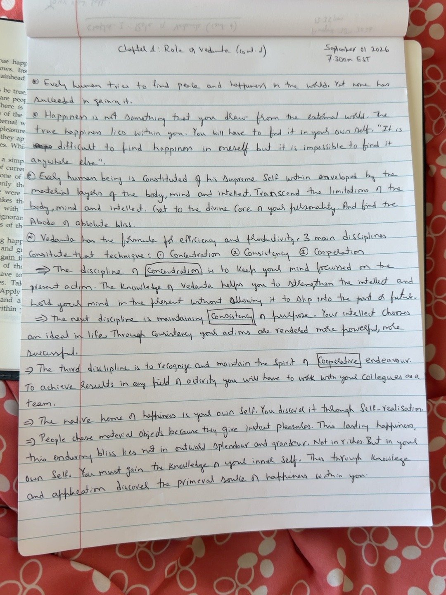

# Concentration, Consistency, Cooperation, and the Source of Happiness

**Study session:** September 1, 2026 — 7:30 AM EST
**Source:** Handwritten continuation of *Chapter 1 — Role of Vedanta*

This page completes the current study of Chapter 1. It brings together the search for happiness, the Vedantic idea of the Self, and three practical disciplines for living and working well.

## The Search for Peace and Happiness

Every human tries to find peace and happiness in the world. Yet none has succeeded in gaining it.

Happiness is not something that you draw from the external world. The true happiness lies within you. You will have to find it in your own Self. “It is difficult to find happiness in oneself but it is impossible to find it anywhere else.”

This note presents a central idea in Vedanta: external circumstances can bring enjoyment, comfort and meaningful experiences, but they cannot guarantee lasting peace. Circumstances change, and the pleasure they provide may also change.

The invitation is not to reject the world or stop enjoying life. It is to investigate whether we expect possessions, recognition, relationships or achievements to provide a permanent sense of completeness. Vedanta directs attention toward understanding the experiencer as well as improving the experience.

The closing quotation is worth noticing: finding happiness within is described as <em>difficult</em>, not easy. The inward search takes effort and honesty.

## The Supreme Self Within

Every human being is constituted of his Supreme Self within, enveloped by the material layers of the body, mind and intellect. Transcend the limitations of the body, mind and intellect. Get to the divine core of your personality and find the abode of absolute bliss.

In the language of these notes, the Self is the deepest reality of a person, while body, mind and intellect are the layers through which everyday life is experienced.

A useful way to approach this teaching is as an inquiry: Am I only the changing contents of my experience — my body, thoughts, emotions, roles and opinions — or is there a deeper dimension of the experiencer to understand? Vedanta asks the seeker to investigate this rather than merely accept it as an idea.

“Transcending” these layers need not mean neglecting them. The body needs care, the mind needs steadiness, and the intellect needs training. The practice is to use these instruments wisely without assuming that they fully define one's identity.

## Three Disciplines of Excellence

Vedanta has the formula for efficiency and productivity. 3 main disciplines constitute that technique: ① Concentration ② Consistency ③ Cooperation

These three disciplines translate study into practical behaviour. They can be applied at work, at home, in learning, and in relationships. They are presented here as the notes' practical framework, not as a guarantee that every outcome will be under our control.

### 1. Concentration — Stay with the Present Action

The discipline of <strong>Concentration</strong> is to keep your mind focused on the present action. The knowledge of Vedanta helps you to strengthen the intellect and hold your mind in the present without allowing it to slip into the past or future.

Concentration means giving the task in front of you your attention instead of repeatedly being pulled away by regret, worry or distraction.

<strong>Everyday example:</strong> During a conversation, listen to what the other person is saying rather than preparing your response, checking your phone or replaying an earlier disagreement. While working, identify the next meaningful action and give it your attention.

Planning for the future and learning from the past are useful. The point is to do each deliberately, then return to the action required now.

### 2. Consistency — Keep Returning to the Ideal

The next discipline is maintaining <strong>Consistency</strong> of purpose. Your intellect chooses an ideal in life. Through consistency your actions are rendered more powerful, more successful.

Consistency is the practice of aligning repeated actions with a considered goal or value. A single burst of effort may begin a change, but habits and progress are usually built through many small returns to the chosen direction.

<strong>Everyday example:</strong> If your ideal is to become a better learner, a regular period of focused study may be more useful than occasional long sessions followed by weeks of inactivity. If your ideal is to be dependable, follow through on commitments even when the initial enthusiasm has faded.

Consistency does not mean stubbornly continuing a bad plan. Reason and reflection help you decide when to persist and when to adjust.

### 3. Cooperation — Work with Others

The third discipline is to recognize and maintain the spirit of <strong>Cooperative</strong> endeavour. To achieve results in any field of activity you will have to work with your colleagues as a team.

Cooperation means recognizing that many worthwhile outcomes depend on people working together. It involves sharing information, listening, respecting different strengths, and aligning efforts around a common purpose.

Cooperation is not the same as agreeing with everyone or abandoning independent thought. It is possible to question an idea respectfully while still helping the group achieve its shared objective.

## The Native Home of Happiness

The native home of happiness is your own Self. You discover it through Self-realisation.

People choose material objects because they give instant pleasures. This lasting happiness, this enduring bliss lies not in outward splendour and grandeur. Not in riches. But in your own Self. You must gain the knowledge of your inner Self. Thus through knowledge and application discover the primeval source of happiness within you.

The notes distinguish <strong>immediate pleasure</strong> from <strong>enduring happiness</strong>. A pleasant meal, a purchase, praise or a successful result can genuinely be enjoyable. The question is whether such experiences can provide lasting peace by themselves.

The practical implication is to participate in life without making every outcome responsible for one's inner state. Work toward goals, nurture relationships and enjoy good experiences, while also developing the capacity to remain thoughtful and balanced when circumstances do not match expectations.

The phrase “knowledge and application” is important: understanding an idea intellectually is only a beginning. Its significance becomes clearer as we observe our habits, apply what we learn, and reflect honestly on the results.

## Chapter 1 — Closing Reflection

Chapter 1 has moved through the role of Vedanta, the stream of experience, freedom and right action, eternal principles, independent thinking, education, practical application, dynamic living, desire, and the relationship between inner understanding and worldly activity.

This page adds a practical set of disciplines:

**Concentration → Consistency → Cooperation**

Together, these ideas suggest a cycle for daily living:

**Gain knowledge → Develop skill → Care for yourself and your environment → Apply the skill → Reflect → Improve**

This is a useful guide, not a demand for perfection. The purpose of reflection is to learn from experience and make the next action wiser — not to expect every first attempt to be flawless.

> **Can I pursue meaningful goals with concentration and consistency, cooperate with others, and still avoid making my peace entirely dependent on the outcome?**

A note of nuance: these are the teachings as understood through the handwritten study notes. The claim that lasting happiness is rooted in the Self is a central Vedantic perspective, not a reason to dismiss practical needs, healthy relationships, material security or support from others. This journal is an invitation to study, question and apply the ideas thoughtfully.

## Check Your Understanding

??? question "1. Why does Vedanta ask us to look within for happiness?"
    Because external experiences can provide pleasure, but they change. Vedanta invites us to investigate whether lasting peace depends on understanding the Self rather than relying entirely on circumstances.

??? question "2. What does it mean to investigate the Self beyond body, mind and intellect?"
    It means questioning whether our changing physical condition, thoughts, emotions and opinions completely define who we are. Vedanta asks the seeker to explore the nature of the experiencer.

??? question "3. What are the three disciplines of excellence in these notes?"
    Concentration, consistency and cooperation: attending to the action at hand, aligning repeated actions with a chosen ideal, and working constructively with others.

??? question "4. Does concentration mean never thinking about the past or future?"
    No. Reflection and planning are useful when done deliberately. Concentration means bringing attention to the task or responsibility that needs attention now.

??? question "5. How can I apply this chapter in daily life?"
    Choose a meaningful action, give it your attention, repeat useful behaviours consistently, cooperate with the people involved, and reflect on what the experience taught you. Use what you learn to improve the next attempt.

## Original Handwritten Page

The typed text above follows this page. The photograph can be replaced later with a clearer scan without changing the study text.
