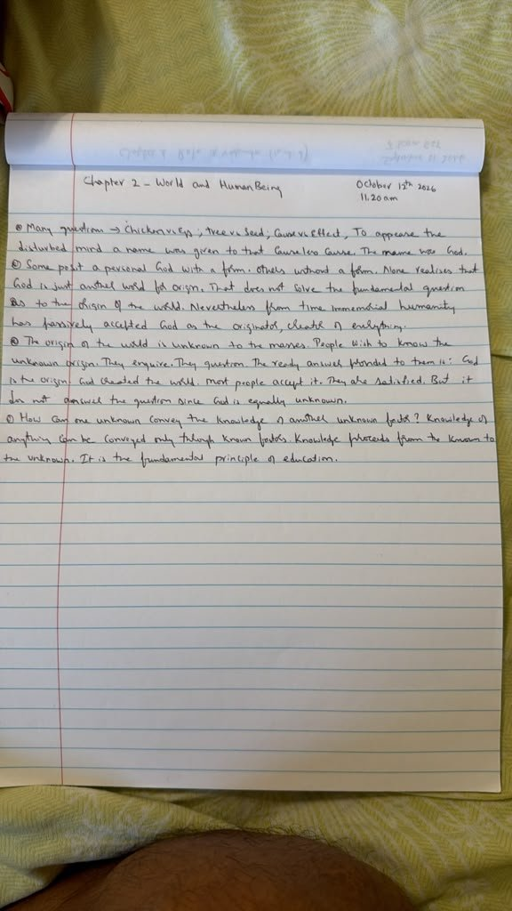
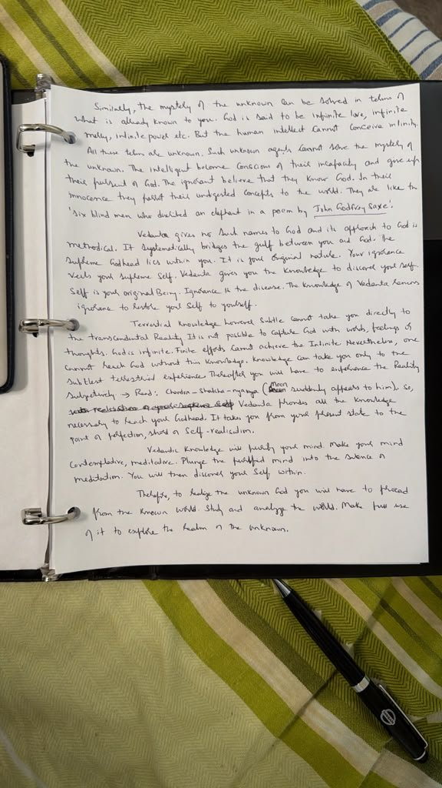

# Mystery of Origin | From the Known to the Unknown

**Topic 1: The mystery of origin — from the known to the unknown**  
**Primary source:** *Vedanta Treatise* by A. Parthasarathy  
**Study note:** Opening section of Chapter 2

This opening section begins with a question that has followed humanity for ages: **Where did the world come from?** It examines why naming an ultimate cause “God” may not, by itself, explain the origin of the world. It then introduces a central method of inquiry: move from what is known to what is not yet known.

The page is organized into three layers: the substance of the study notes, an explanation of the ideas, and questions for personal inquiry. The explanations are aids to understanding, not a substitute for examining the original text and testing its ideas through reflection.

## 1. The Question of the First Cause

① Many questions → Chicken vs Egg; Tree vs Seed; Cause vs Effect. To appease the disturbed mind a name was given to that Causeless Cause. The name was God.

② Some posit a personal God with a form. Others without a form. None realises that God is just another word for origin. That does not solve the fundamental question as to the origin of the world. Nevertheless from time immemorial humanity has passively accepted God as the originator, creator of everything.

The examples point to a familiar puzzle. A chicken comes from an egg, yet an egg comes from a chicken. A tree grows from a seed, while a seed comes from a tree. When we keep asking what caused something, we can feel compelled to search for a first cause—something that did not itself arise from an earlier cause.

The notes call this the “Causeless Cause” and observe that people have given it the name “God.” But a name is not necessarily an explanation. Calling the origin “God” identifies what we are talking about; it does not automatically tell us what that origin is or how the world arises from it.

The notes also distinguish between conceptions of God with form and without form. Their point here is that either conception still leaves the underlying question open if the nature of the origin remains unknown.

**Question to pause over:** Have I understood something more deeply, or have I only given the mystery a name?

## 2. Can One Unknown Explain Another?

③ The origin of the world is unknown to the masses. People wish to know the unknown origin. They enquire. They question. The ready answer provided to them is: God is the origin. God created the world. Most people accept it. They are satisfied. But it does not answer the question since God is equally unknown.

The argument turns on the difference between an answer that sounds satisfying and an answer that actually increases understanding.

Suppose I ask why a machine has stopped working and someone replies, “There is a problem with it.” The statement may be true, but it has not explained the cause. I still need to discover what the problem is.

In the same way, if both the world's origin and the proposed explanation of that origin are unknown to me, simply replacing one unknown with another does not complete the inquiry. The notes challenge us to look more carefully rather than stop at a familiar answer.

This is a question about the method of explanation, not a demand that every person adopt the same belief about God. The useful discipline is to recognize what we know, what we do not know, and what an answer has genuinely helped us understand.

## 3. Knowledge Proceeds from the Known to the Unknown

④ How can one unknown convey the knowledge of another unknown factor? Knowledge of anything can be conveyed only through known factors. Knowledge proceeds from the known to the unknown. It is the fundamental principle of education.

Similarly, the mystery of the unknown can be solved in terms of what is already known to you. God is said to be infinite love, infinite mercy, infinite power etc. But the human intellect cannot conceive infinity.

All these terms are unknown. Such unknown agents cannot solve the mystery of the unknown. The intelligent become conscious of their incapacity and give up their pursuit of God. The ignorant believe that they know God. In their innocence they foist their undigested concepts to the world. They are like the "six blind men who described an elephant in a poem by John Godfrey Saxe".

This is the guiding principle of the section: **start with what can be understood, then use it to investigate what is not yet understood.**

Education works this way. A learner approaches a new idea through familiar examples, language, observations, or earlier knowledge. If the starting point is just as obscure as the thing being explained, the explanation cannot do much work.

The notes apply this principle to descriptions such as “infinite love,” “infinite mercy,” and “infinite power.” We may understand love, mercy, and power through finite human experiences, but the word “infinite” points beyond what the ordinary intellect can fully picture. The notes therefore ask whether these descriptions, by themselves, truly explain the unknown.

The reference to John Godfrey Saxe's poem about six blind men and an elephant illustrates the danger of mistaking a partial view for the whole. Each person touches a different part of the elephant and describes the entire animal from that limited experience. Their mistake is not simply that they have no information; it is that they treat incomplete information as complete.

The lesson is to remain intellectually honest. We can acknowledge the limits of our understanding without pretending to possess the whole truth—and without abandoning inquiry altogether.

## 4. Vedanta's Method: Turn the Inquiry Toward the Self

Vedanta gives no fixed names to God and its approach to God is methodical. It systematically bridges the gulf between you and God. The Supreme Godhead lies within you. It is your original nature. Your ignorance veils your Supreme Self. Vedanta gives you the knowledge to discover your Self. Self is your original Being. Ignorance is the disease. The knowledge of Vedanta removes ignorance to restore your Self to yourself.

Having questioned an answer that merely names the unknown, the notes introduce Vedanta as a systematic approach. Instead of asking the seeker simply to accept a description of God, Vedanta directs attention toward the one field of experience immediately available for investigation: oneself.

The passage expresses a central Vedantic teaching: the deepest Self is not something newly manufactured or acquired. It is described as one's original nature, obscured by ignorance. In this analogy, knowledge does not create the Self; it removes misunderstanding about what one truly is.

The image of illness and cure makes the point memorable. If ignorance is the problem, then the remedy is knowledge—not the accumulation of more labels or unexamined beliefs. The phrase “restore your Self to yourself” suggests uncovering what was overlooked rather than becoming something entirely new.

These are significant philosophical claims, and the study invites us to examine them carefully. What do I usually call “myself”? Which parts of that understanding are based on direct observation, and which are assumptions I have inherited or formed?

## 5. The Reach and the Limit of Intellectual Knowledge

Terrestrial knowledge however subtle cannot take you directly to the transcendental Reality. It is not possible to capture God with words, feelings or thoughts. God is infinite. Finite efforts cannot achieve the Infinite. Nevertheless, one cannot reach God without this knowledge. Knowledge can take you only to the subtlest terrestrial experience. Thereafter you will have to experience the Reality subjectively. → Read: Chandra – Shakha – nyaya (Moon suddenly appears to him). So, Vedanta provides all the knowledge necessary to reach your Godhead. It takes you from your present state to the point of perfection, stage of Self-realisation.

This passage holds two ideas together.

First, intellectual knowledge has a limit. Words, concepts, and thoughts can point toward Reality, but a description is not the same as direct realization. Reading a description of silence, for example, is different from becoming quiet and experiencing silence for oneself.

Second, the notes do not dismiss study. They say that knowledge is necessary because it prepares the seeker and carries the inquiry as far as conceptual understanding can take it. The next step, in this account, is not merely to repeat an idea but to investigate it in one's own experience.

The reference to *Chandra–Shakha–Nyaya* appears to point to the traditional “moon and branch” illustration: a branch may help someone locate the moon, but the branch is not the moon itself. The pointer serves its purpose when the observer sees what it indicates. This explanation is offered as a reading of the reference; the original source should be consulted for its precise traditional formulation.

The distinction is practical: study can clarify the direction, and reflection can test understanding, but neither should be confused with the direct seeing to which the teaching points.

## 6. Knowledge Prepares the Mind for Meditation

Vedantic Knowledge will purify your mind. Make your mind contemplative, meditative. Plunge the purified mind into the silence of meditation. You will then discover your Self within.

Here, knowledge is presented as a transformation of the mind, not merely as information to collect. Understanding can help expose confused assumptions, habitual reactions, and mistaken ideas. As these become clearer, the mind may become more available for sustained reflection and meditation.

Notice the sequence in the notes:

1. Study Vedantic knowledge.
2. Allow that knowledge to clarify and purify the mind.
3. Develop a contemplative and meditative disposition.
4. Enter silence and investigate the Self directly.

This is not a claim that simply reading a page guarantees realization. It is a description of the role that study is intended to play in a larger discipline. The invitation is to let learning influence how we observe, think, and live.

## 7. Begin with the World We Know

Therefore, to realize the unknown God you will have to proceed from the known world. Study and analyze the world. Make full use of it to explore the realm of the unknown.

This closing thought connects the opening section to the chapter's title, *World and Human Being*. If inquiry must begin with what is known, then the experienced world—and our experience of being human—becomes the starting point.

The world is not simply a distraction to be rejected. It is what we can observe, question, and analyze. We can study change and permanence, cause and effect, our bodies, our thoughts, our desires, and the nature of the one who experiences them. Such investigation begins with familiar experience and gradually raises subtler questions.

The movement is therefore not from blind acceptance to another ready-made answer. It is from observation, through careful reasoning and study, toward deeper inquiry and ultimately the direct realization described by Vedanta.

## The Thread That Connects the Section

The argument develops step by step:

- **A question arises:** What is the origin of the world?
- **A limitation is exposed:** Giving the unknown a name does not necessarily explain it.
- **A method is proposed:** Knowledge proceeds from the known to the unknown.
- **The inquiry becomes personal:** Vedanta directs attention toward the nature of the Self.
- **The role of study is clarified:** Knowledge prepares the mind but is not identical to direct realization.
- **The next step is indicated:** Study the world and human experience as the starting point of inquiry.

The practical challenge is to resist the urge to settle a profound question too quickly. Begin with what can be observed, distinguish understanding from assumption, and let each answer lead to a clearer question when necessary.

## Reflection to Carry Forward

> **When I say “God is the origin of the world,” what have I genuinely understood—and what remains unknown to me?**

A second question to keep nearby:

> **What do I know directly about the world and myself that could become the starting point for deeper inquiry?**

There is no need to force an immediate conclusion. The aim is to become more precise about what is known, more honest about what is not known, and more willing to investigate.

## Check Your Understanding

??? question "1. What is meant by the “Causeless Cause”?"
    It is the proposed first cause that is not itself caused by something earlier. The notes observe that calling it “God” gives it a name but does not, by itself, explain its nature.

??? question "2. Why might “God created the world” leave the original question unanswered?"
    In the reasoning of the notes, if both the origin of the world and God remain unknown to the inquirer, the answer has named an unknown rather than explained it.

??? question "3. What does “knowledge proceeds from the known to the unknown” mean?"
    Learning starts from something the learner can understand and uses it to investigate something less familiar. A useful explanation builds a bridge from known experience to a new idea.

??? question "4. What is the purpose of the six blind men and the elephant illustration?"
    It warns against treating a limited perspective as the complete truth. Each person experiences one part and mistakes that part for the whole.

??? question "5. According to this passage, what does Vedanta say is veiled by ignorance?"
    The Supreme Self, described in the notes as one's original nature. Vedantic knowledge is presented as removing ignorance rather than creating the Self.

??? question "6. If words and thoughts cannot capture Reality, why is knowledge still necessary?"
    The passage presents knowledge as a guide that clarifies the inquiry and prepares the mind. It points toward direct experience without being identical to that experience.

??? question "7. Why does the section conclude by directing us to study the world?"
    Because the world is the starting point available to observation and analysis. The notes propose using known experience to investigate what is not yet understood.

## Original Handwritten Pages

The handwritten pages are retained as the primary record. The study text above develops their ideas with explanations and reflection prompts; interpretations are intended to support continued study rather than replace the source.
